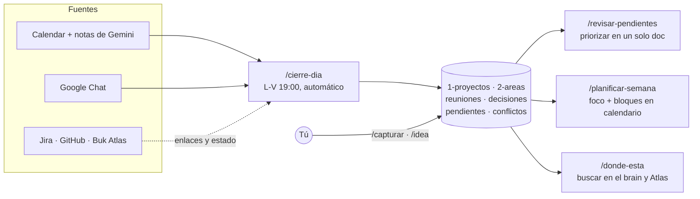

# 🧠 Second Brain para PMs

Un "segundo cerebro" en archivos markdown que **se alimenta solo**: cada tarde, Claude Code (o Codex) lee tus reuniones del día, sus notas de Gemini y tus hilos de Google Chat; los ordena por proyecto y extrae **decisiones, pendientes y conflictos**. Tú solo revisas, priorizas y decides en qué enfocarte.

Está organizado con el método **PARA** (Proyectos, Áreas, Recursos, Archivo) y trae listas las reglas, las skills y la rutina diaria. Cada persona lo configura con un solo archivo, `perfil.md`; los valores internos de Buk llegan en otro, `organizacion.md`, que se pide aparte.

> **Es una plantilla.** Crea tu copia **privada** con **Use this template**: tu brain va a guardar notas de reuniones, decisiones y temas de personas. No hagas forks públicos.

## Cómo funciona



- **Fuentes crudas antes que IA**: extrae desde la transcripción verbatim; el resumen de Gemini es la última opción y se marca.
- **Tus pendientes, no los del equipo**: un filtro estricto deja solo lo que tú tienes que hacer, pediste, esperas o delegaste a un reporte directo. La ejecución del equipo sigue en Jira.
- **Cierra lo que ya se hizo**: si en una reunión alguien dice "ya lo mandé", el pendiente se cierra solo, con la cita como evidencia para que puedas revertirlo.
- **Nada sale de tu máquina sin preguntar**: correos, mensajes, eventos y tickets siempre piden confirmación. Escribir en el brain es libre.
- **Las skills aprenden**: si un comando falla, la skill anota la causa y la solución en su sección `## Aprendizajes`.

## Empezar

**Requisitos**: macOS o Linux, git, [Claude Code](https://code.claude.com) (o Codex; la rutina automática usa Claude Code), y las CLIs de las fuentes que uses (todas opcionales salvo la de Google):

| CLI | Para qué | Cómo |
|---|---|---|
| `gws` | Calendar, Drive, Chat, Gmail, Buk Atlas | viene con buk-cli (guía interna de Buk) |
| `gh` | GitHub | `brew install gh && gh auth login` |
| `acli` | Jira | `brew tap atlassian/homebrew-acli && brew install acli && acli jira auth login --web` |
| `bq` | BigQuery | viene con buk-cli / Google Cloud SDK |

**Pasos**:

1. **Use this template** → *Create a new repository* → visibilidad **Private**.
2. Clónalo fuera de Escritorio y Documentos (macOS restringe esas carpetas a las tareas programadas):
   ```bash
   git clone git@github.com:<tu-usuario>/<tu-brain>.git ~/brain && cd ~/brain
   ```
3. **Pídele a Pablo Troncoso el archivo `organizacion.md`** y déjalo en la raíz de la carpeta que clonaste, junto a `perfil.md`. Trae los valores internos de Buk (Jira, GitHub, BigQuery, Buk Atlas) que no se publican en este repo; con él, `/configurar` no te pregunta nada de eso. ¿No eres de Buk? Copia `organizacion.ejemplo.md` como `organizacion.md` y complétalo.
4. Abre el agente y corre la configuración guiada:
   ```bash
   claude          # y escribe: /configurar
   codex           # o, en Codex: $configurar
   ```
   Te pregunta tu nombre, rol, reportes directos y pares; verifica las CLIs; crea el área de tu equipo; instala la rutina diaria y revisa que tu repo sea privado.
5. `/para-init` — propone tus proyectos y áreas a partir de tus últimas 2 semanas de Calendar, Gmail, Drive y Chat. Tú confirmas cuáles crear.
6. `/mapear-chat-spaces` — asocia tus spaces de Chat a esos proyectos.
7. Al final del día, `/cierre-dia` (o espera a que corra solo) y revisa lo que dejó.

¿Dudas en cualquier paso? Pregúntale al agente dentro del repo ("¿cómo cambio la hora de la rutina?", "no uso Jira, ¿qué hago?"): el [`AGENTS.md`](AGENTS.md) tiene la guía de configuración.

## Skills

| Skill | Qué hace |
|---|---|
| **Configuración** | |
| `/configurar` | Configuración guiada: perfil, fuentes, área del equipo, Codex, rutina y privacidad del repo |
| `/para-init` | Propone proyectos y áreas desde tu actividad reciente |
| `/mapear-chat-spaces` | Asocia spaces de Google Chat a proyectos y áreas |
| **Rutina** | |
| `/cierre-dia [fecha]` | Procesa reuniones y Chat del día: notas, decisiones, pendientes, conflictos y cierres |
| `/planificar-semana [lunes]` | Elige el foco de la semana (máx. 4 bloques de foco) y propone bloques en tu calendario |
| **Captura** | |
| `/capturar "<nota>"` | Archiva una nota en el lugar correcto sin que elijas destino |
| `/idea "<concepto>"` | Crea una idea de proyecto futuro con plantilla |
| **Gestión** | |
| `/revisar-pendientes` | Junta todos tus pendientes en un documento, lo editas y aplica los cambios en masa |
| **Búsqueda** | |
| `/donde-esta "<concepto>"` | Busca en el brain y, si no basta, en Buk Atlas |
| `/atlas "<consulta>"` | Busca directo en Buk Atlas |
| **Sync** | |
| `/jira-mios` · `/jira-ticket KEY-1` | Snapshot de tus tickets por proyecto · detalle de un ticket |
| `/mis-prs` · `/pr <num>` | Snapshot de tus PRs por proyecto · detalle de un PR |
| `/datos "<pregunta>"` · `/amplitude "<pregunta>"` | Pregunta en lenguaje natural → SQL en BigQuery (siempre confirma antes de ejecutar) |
| `/skills` | Lista todas las skills |

En Codex se invocan igual, con `$` en vez de `/` (`$cierre-dia`).

## Estructura

```
.
├── AGENTS.md              # reglas del sistema + guía de configuración (lo leen Claude Code y Codex)
├── perfil.md              # ← lo único que configuras: quién eres, equipo, fuentes, horarios, portafolio
├── organizacion.md        # valores internos de Buk: se pide aparte, no se versiona (ver organizacion.ejemplo.md)
├── 1-proyectos/<slug>/    # AGENTS.md, reuniones/, chat/, decisiones/, pendientes.md, conflictos.md, refs/
├── 2-areas/<slug>/        # misma forma; 1-a-1s/ viene creada (una carpeta por persona)
├── 3-recursos/            # plantillas/, frameworks/, ideas-proyectos/, queries/, inboxes
├── 4-archivo/             # proyectos terminados (no se borran)
├── .claude/
│   ├── commands/          # las skills (fuente única)
│   ├── routines/          # rutina diaria (launchd / cron) y brain-sync
│   └── settings.json      # permisos: lectura libre, acciones externas siempre preguntan
└── .agents/skills/        # adaptadores para Codex (generados por .agents/sync-skills.sh)
```

## Personalizar

| Quiero… | Edito |
|---|---|
| Cambiar mis datos, equipo, fuentes, horarios o cupo de foco | `perfil.md` |
| Actualizar los valores de Buk (Jira, BigQuery, Atlas…) | reemplazar `organizacion.md` por la versión nueva que comparta Pablo |
| Desactivar una fuente que no uso (Jira, BigQuery…) | `perfil.md` §3 → `inactiva` |
| Cambiar la forma de los proyectos y áreas nuevos | `3-recursos/plantillas/` |
| Ajustar o crear una skill | `.claude/commands/<skill>.md` y después `bash .agents/sync-skills.sh` |
| Cambiar la hora de la rutina o pausarla | `bash .claude/routines/instalar-rutina.sh 18:30` · `--desinstalar` |
| Dar o quitar permisos solo para mí | `.claude/settings.local.json` (ignorado por git) |

## Recibir mejoras de la plantilla

```bash
git remote add plantilla <url-de-este-repo>
git pull plantilla main --allow-unrelated-histories   # la primera vez; después: git pull plantilla main
```

Si un conflicto cae en una sección `## Aprendizajes`, conserva lo de ambos lados. ¿Tu agente aprendió algo que le sirve a todos (una rareza de `gws`, un mejor filtro)? Propónlo como PR a este repo.

## Privacidad

- Tu brain va en un **repo privado** al que solo tú accedes. `/configurar` lo verifica.
- En `perfil.md` §5 eliges el nivel de detalle para temas sensibles (desempeño, feedback, compensación): `completo` si solo tú lo lees, `metadata` si no.
- Los IDs internos de Buk viven en `organizacion.md`, que está en `.gitignore` y no se sube a ningún repo.
- Nunca se guardan tokens ni contraseñas.

## Origen

Generalizado a partir del second brain que Pablo Troncoso usa a diario como Group Product Manager en Buk. Se inspira en [Building a Second Brain](https://www.buildingasecondbrain.com/) de Tiago Forte y en [cómo Meta construyó un second brain con IA](https://medium.com/@AnalyticsAtMeta/how-we-built-an-ai-second-brain-for-60k-knowledge-workers-78c507dd795b).
